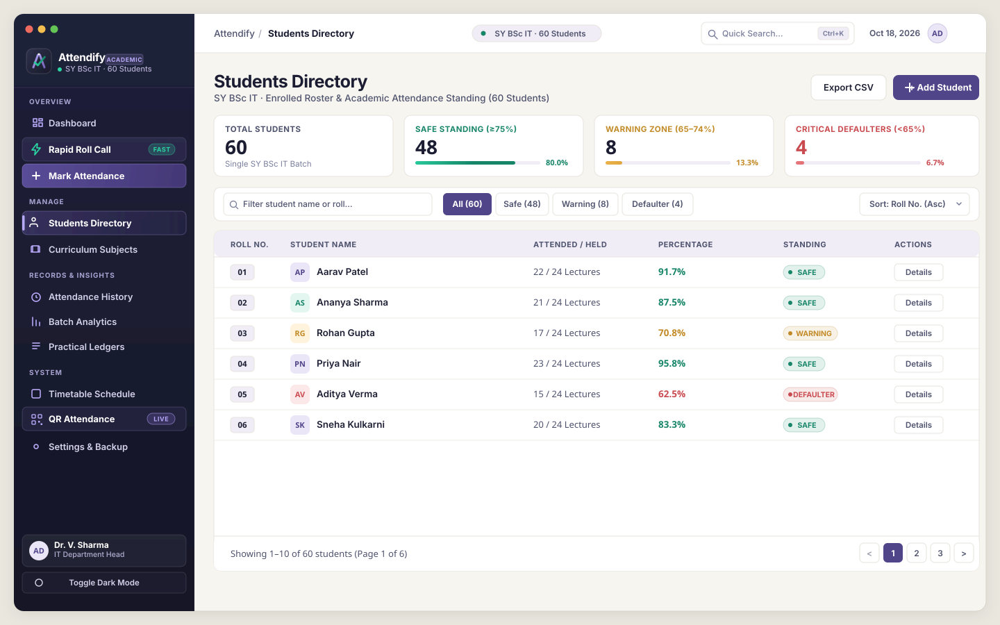

<div align="center">

  

  # Attendify
  ### Professional Academic Attendance Management & Faculty Workflow Platform

  [-51458A?style=for-the-badge)](#-technology-stack)
  [-178568?style=for-the-badge)](#-test-suite--quality-assurance)
  [](#4--dedicated-student-only-portal--strict-visibility-rule-new)
  [](#-typography--design-tokens)
  [](#-state-engine--data-reliability)
  [](#)

  <p align="center">
    <strong>A refined, Apple-inspired academic SaaS application built for university faculty, department coordinators, and proctors to take, manage, analyze, and print attendance for 60 students in under 60 seconds.</strong>
  </p>

  <br />

  

</div>

---

## 📑 Table of Contents

- [Vision & North-Star Workflow](#-vision--the-under-60-seconds-workflow)
- [Key Features & Modules](#-key-features--modules)
  - [⚡ Rapid Roll Call Studio](#1--rapid-roll-call-studio-new)
  - [Unified Attendance Register](#2-unified-attendance-register)
  - [📱 Rotating QR Attendance (Server-Validated Security)](#3--rotating-qr-attendance--server-validated-security-new)
  - [🎓 Dedicated Student-Only Portal (Strict Visibility Rule)](#4--dedicated-student-only-portal--strict-visibility-rule-new)
  - [Students Directory](#5-students-directory)
  - [Curriculum & Subjects](#6-curriculum--course-management)
  - [Audited Attendance History](#7-audited-attendance-history)
  - [Analytics & Defaulter Tracking](#8-analytics--defaulter-tracking)
  - [Printable Practical Ledgers](#9-printable-practical-reports)
  - [Weekly Timetable Engine](#10-weekly-timetable-engine)
- [Design System & UI Tokens](#-design-system--visual-identity)
  - [Color Palette](#color-palette)
  - [Typography Stack](#typography-system)
  - [Motion Design & Micro-Interactions](#motion-design-system)
  - [Animated Scrollbar Architecture](#animated-scrollbar-architecture)
- [State Engine & Data Reliability](#-state-engine--data-reliability)
- [Keyboard Shortcuts Reference](#-keyboard-shortcuts-reference)
- [Local Setup & Deployment](#-local-setup--deployment)
- [Test Suite & Quality Assurance](#-test-suite--quality-assurance)

---

## 🎯 Vision & The Under-60-Seconds Workflow

In university classrooms with 60 students, roll call traditionally consumes 10–15 minutes of lecture time and produces error-prone paper registers.

**Attendify eliminates this friction entirely.** Built around an operational benchmark:
> *"A professor or faculty proctor should be able to mark attendance for 60 students, verify exceptions, and synchronize the entire academic ledger in under 60 seconds."*

### The Core Speed Flow
1. **Open Attendify** → Launch the **⚡ Rapid Roll Call** or **+ Mark Attendance** from the left sidebar.
2. **Select Course & Session Type** (Lecture theory or Laboratory practical).
3. **All 60 enrolled students load pre-reconciled**.
4. **Mark exceptions in seconds**:
   - Use the **Speed Card** with hotkeys (`P`, `A`, `L`, `Space`) with optional sensory sound chimes.
   - Use the **Interactive Seating Grid** to toggle absentees with 1 click.
   - Or use **Absentee Call-Out** to type only absent roll numbers (e.g. `4, 12, 19, 45`).
5. **Real-time Headcount Reconciles**: `Present + Absent + Late = 60`.
6. **Save & Commit**: Synchronizes with localStorage backup rotation, updates batch averages, recalculates defaulters (<75%), and updates printable reports.

---

## 🚀 Key Features & Modules

### 1. ⚡ Rapid Roll Call Studio (`js/rapid-roll.js`)
A next-generation attendance workbench designed for high-turnout university lectures:
* **Mode 1: Speed Roll (Card Flow)**:
  - Displays one student at a time with a massive roll number badge, monogram avatar, full student name, and attendance history.
  - One-tap keyboard controls: `[P] / [Space]` for Present, `[A]` for Absent, `[L]` for Late, `[←] / [→]` to navigate.
  - Auto-advances to the next student immediately upon marking.
  - **Sensory Web Audio Feedback**: Plays a gentle, synthesized chime on marks (zero external audio files, pure Web Audio API oscillator synthesis). Can be toggled ON/OFF.
* **Mode 2: Interactive Seating & Turnout Grid**:
  - Displays all 60 students in an interactive, responsive grid of status tiles.
  - Single click toggles student status (`Present` → `Absent` → `Late` → `Present`).
* **Mode 3: Instant Absentee Call-Out**:
  - In classrooms where 90%+ of students are present, simply type absentee roll numbers separated by commas: `3, 11, 24, 52`.
  - Clicking **Apply Absentees** automatically marks those students as Absent and all remaining 50+ students as Present.
* **Live Reconciled HUD**: Real-time progress bar (e.g. `Student 24 of 60 (40%)`), Present / Absent / Late / Unmarked counts, and projected turnout percentage.
* **Auto-Draft Preservation**: Automatically caches drafting progress in localStorage so accidental page refresh never loses marks.

### 2. Unified Attendance Register (`js/mark-attendance.js`)
* **Lecture & Practical Categorization**: Toggle between standard lectures and lab practicals (with experiment title and journal tracking).
* **Timetable Slot Prefill**: One-click chips to prefill course and timing based on the current day's timetable.
* **Bulk Power Actions**: `All Present`, `Mark Remaining Present`, `Invert Marks`, `Copy Previous Session`, `Reset Register`.
* **Collision Safety**: Warns professors before overwriting an existing session for the same date and time.
* **Full Undo Engine**: Multi-level `Ctrl+Z` undo stack.

### 3. 📱 Rotating QR Attendance & Server-Validated Security (`js/qr-attendance.js`, `qr-backend.js`, `checkin.html`)
A university-grade touchless attendance module positioned in the primary sidebar immediately below Timetable:
* **Cryptographically Unpredictable Rotating QR Codes**:
  - Automatically regenerates every 20 seconds (configurable 15–45s) using server-side 24-byte `crypto.randomBytes` hex tokens.
  - Generates zero-dependency SVG vector QR codes on the fly via Kazuhiko Arase's QR algorithm ([`js/qrcode.js`](file:///c:/Users/PRATEEK%20DUBEY/Downloads/Attendify/js/qrcode.js)).
  - Clean animated radial & linear countdown indicators displaying time remaining before the next token rotation.
* **Server-Validated Security Architecture**:
  - **Zero Trust Client Verification**: Tokens, timestamps, enrollment status, and session validity are strictly verified server-side (`POST /api/qr/session/checkin`).
  - **5-Second Grace Window**: Accommodates students whose scan occurred right before rotation while strictly rejecting replayed or expired tokens.
  - **Strict Anti-Duplicate Submissions**: A student cannot submit attendance twice for the same active session.
  - **Rate Limiting & Threat Logging**: Sliding rate limiter protects against brute-force token scans; every check-in, replay attempt, and manual correction is recorded in a tamper-evident audit log.
* **Real-Time Live Classroom Roster**:
  - Live headcount displays `Checked-in`, `Pending`, and `Turnout %` out of the 60 enrolled cohort.
  - Live activity table reflects each student's timestamped check-in immediately.
  - Faculty can review exceptions, flag suspicious submissions, and manually toggle student status with audit logging.
* **Mobile Student Check-In Portal (`checkin.html`)**:
  - Mobile-first, responsive interface opened when students scan the QR code (`?s=<sessionId>&t=<token>`).
  - Student selects their roll number; portal validates token freshness with the server and gives instant haptic confirmation.
  - Prevents fraudulent off-campus sharing through dynamic short token expiry.
* **Direct State Engine Integration**:
  - Finalizing attendance cleanly commits to `State.createSession` and `State.saveRecords`, synchronizing with History, Analytics, and Reports with zero duplicate schema or orphan records.

### 4. 🎓 Dedicated Student-Only Portal (`student.html`, `student-backend.js`)
A lightweight, separate portal built specifically for students to submit attendance and monitor personal compliance:
* **Strict Student Permissions**:
  - Authenticated via cryptographically random 28-byte bearer tokens (`POST /api/student/login` with Roll Number + 4-digit PIN).
  - Students can **only** view classes currently active for attendance submission, submit their presence, and review their own personal record.
  - No access to faculty views, mark alteration controls, or other students' attendance records.
* **Critical Attendance Visibility Rule (Enforced on Backend & UI)**:
  - **Before Confirmed Submission**: All attendance totals, percentages, subject breakdowns, and past records are **strictly withheld by the server** (`GET /api/student/attendance-summary` returns `visibilityGranted: false` and omits all metrics).
  - The UI displays a clear locked state banner explaining that university policy requires confirmed attendance for the active class before semester percentages are revealed.
  - **After Confirmed Submission**: The server validates the check-in, unlocks the record, and transmits the student's personal attendance statistics (`visibilityGranted: true`).
  - Totals are **never** revealed merely because a student opened the page or logged in; the server-confirmed submission is the sole unlock trigger.
* **Single Student Identity Validation**:
  - Roll numbers and identities are strictly bound to the authenticated server token (`req.student.id`), completely preventing URL spoofing or roll number manipulation.
  - Duplicate submissions for the same class are rejected on the server.

### 5. Students Directory (`js/students.js`)
* Complete roster of all **60 enrolled students** (Roll Numbers 1 to 60) in the single SY BSc IT cohort.
* Monogram avatars with deterministic color palette matching student identity.
* Attendance metrics per student: Total Sessions, Attended, Missed, Percentage, and Status Pill.
* University compliance status pills:
  - `SAFE`: $\ge 75\%$
  - `WARNING`: $65\% \le \text{Attendance} < 75\%$
  - `CRITICAL / DEFAULTER`: $< 65\%$
* Interactive filter pills (`All`, `Safe`, `Warning`, `Defaulter`), search box with debounce, and paginated table.
* **Student Detail Drawer**: Breakdown of attendance across every curriculum subject and date log.

### 6. Curriculum & Course Management (`js/subjects.js`)
* Pre-configured with the complete SY BSc IT curriculum:
  - *Python Programming* (PP) — Prof. Deshmukh
  - *Data Structures & Algorithms* (DSA) — Dr. Kulkarni
  - *Computer Networks* (CN) — Prof. Iyer
  - *Database Management Systems* (DBMS) — Dr. Mehta
  - *Software Engineering* (SE) — Prof. Joshi
* Tracks total sessions held, average batch turnout %, and allows editing course codes and teachers.

### 7. Audited Attendance History (`js/history.js`)
* Comprehensive audit ledger of all completed sessions.
* Filter by Subject, Session Type (Lecture / Practical), or Date Range.
* Edit recorded marks or safely delete sessions with state cascade.

### 8. Analytics & Defaulter Tracking (`js/analytics.js`)
* High-density visual breakdown: Safe vs. Warning vs. Defaulter distribution.
* Course comparison bar charts showing subjects with highest and lowest turnout.
* Export Defaulters List CSV for university administration.

### 9. Printable Practical Reports (`js/practical-reports.js`)
* Formats laboratory experiments into official university academic documents.
* Generates printable practical attendance sheets with institution header, experiment titles, roll numbers, attendance checkboxes, and faculty signature blocks.
* CSS print stylesheets optimized for clean black-and-white physical printing.

### 10. Weekly Timetable Engine (`js/timetable.js`)
* Weekly schedule mapping Monday through Saturday with subject and classroom assignments.
* Integrates directly into attendance screens to automatically suggest the current lecture slot.

---

## 🎨 Design System & Visual Identity

Attendify's visual identity balances **refined academic SaaS, Apple-inspired minimalism, and tactile motion design**.

### Color Palette

| Token | Hex | Semantic Usage |
|---|---|---|
| `--bg` | `#F7F5F0` | Warm ivory canvas background |
| `--surface` | `#FFFFFF` | Primary surface for cards, tables, forms |
| `--surface-subtle` | `#F0EDF7` | Soft lavender-tinted secondary regions and headers |
| `--ink` | `#1C1F33` | Primary text: deep, rich, high contrast |
| `--ink-secondary` | `#4E526D` | Descriptions, subtitles, and metadata (WCAG AAA) |
| `--ink-tertiary` | `#787D9C` | Captions, timestamps, and subtle hints |
| `--accent` | `#51458A` | Primary brand accent: buttons and active elements |
| `--accent-hover` | `#40356F` | Primary button hover state |
| `--soft-accent` | `#EAE5F7` | Soft lavender selection highlight |
| `--safe` | `#178568` | Present status, safe attendance ($\ge 75\%$) |
| `--warn` | `#C28A25` | Late status, warning zone ($65\%-74\%$) |
| `--critical` | `#C94B50` | Absent status, critical defaulter ($< 65\%$) |
| `--border` | `#E7E4DE` | Card and divider outlines |
| `--sidebar-bg` | `linear-gradient(#1E2038, #161726)` | Deep-navy sidebar with lavender undertones |

### Typography System
* **Primary Interface Font**: [Quicksand](https://fonts.google.com/specimen/Quicksand) (Weights: `500` normal, `600` labels/nav, `700` titles).
* **Numerical & Data Font**: [DM Sans](https://fonts.google.com/specimen/DM+Sans) (Weights: `500`, `700`) with `font-feature-settings: "tnum" 1` for tabular numeral alignment in attendance counts, percentages, and roll numbers.

### Motion Design System
* `--ease-spring`: `cubic-bezier(0.16, 1, 0.3, 1)` — physics-based spring curve for view entrances and modal popups.
* `--ease-bounce`: `cubic-bezier(0.34, 1.56, 0.64, 1)` — tactile micro-bounce on status buttons and active nav indicators.
* **Tactile Press Feedback**: Buttons physically compress to `scale(0.965)` on active click and snap back smoothly.
* **Card Elevation Lift**: Cards float `-2.5px` on hover with diffuse depth shadows.
* Full `@media (prefers-reduced-motion: reduce)` accessibility compliance.

### Animated Scrollbar Architecture
* Eliminated bulky 17px default OS scrollbars from the shell, sidebar navigation, and toolbars (`scrollbar-width: none`).
* Implemented custom 6px ultra-slim capsule scrollbars on scrollable viewports with translucent lavender thumbs that smoothly expand and glow on hover.

---

## 🔒 State Engine & Data Reliability

Attendify uses a zero-dependency, reactive data store:
* **Reactive Dispatcher**: Views re-render automatically when data changes without full-page reloads.
* **Backup Key Rotation**: Every `State.save()` safely rotates the current working state to `attendify:v2:backup` before writing the primary key. If the primary JSON ever becomes corrupted (e.g. abrupt power outage), the system automatically recovers from the backup key without data loss.
* **Referential Integrity**: Cascading deletes ensure that removing a course cleanly purges corresponding timetable slots and attendance records without leaving orphan pointers.
* **Data Validation**: Strict payload schema validation ensures roll numbers remain within $[1, 60]$, status enums match `present|absent|late|unmarked`, and dates are ISO-compliant.

---

## ⌨️ Keyboard Shortcuts Reference

| Shortcut | Scope | Action |
|---|---|---|
| `Ctrl + K` / `Cmd + K` | Global | Open Global Search modal |
| `Escape` | Global | Close any active modal, dialog, or drawer |
| `P` or `Space` | Rapid Roll Call | Mark active student **Present** & advance to next |
| `A` | Rapid Roll Call | Mark active student **Absent** & advance to next |
| `L` | Rapid Roll Call | Mark active student **Late** & advance to next |
| `←` / `→` (Arrows) | Rapid Roll Call | Navigate to Previous / Next student card |
| `Ctrl + Z` / `Cmd + Z` | Mark Attendance | Undo last attendance change |
| `↓` / `↑` (Arrows) | Register Table | Move focus up and down student rows |

---

## 💻 Local Setup & Deployment

Attendify is completely self-contained with **zero npm dependencies**.

### Prerequisites
* [Node.js](https://nodejs.org/) v18.0.0 or higher (or any modern web browser).

### Running Locally
```bash
# 1. Clone the repository
git clone https://github.com/your-username/attendify.git
cd attendify

# 2. Start the local server
npm start
# or directly:
node server.js

# 3. Open your browser
### Database Architecture & ACID Persistence (`schema.sql`, `database.js`)
Attendify features an enterprise-grade, relational SQL database engine powered by Node.js native `node:sqlite` DatabaseSync with zero external dependencies:
* **Persistent Disk Storage (`attendify.db`)**: Attendance sessions, verified student check-ins, security audit logs, faculty accounts, and enrolled students persist permanently across server restarts.
* **ACID Transactions**: Attendance validation, token rotation, and check-in confirmation execute in `BEGIN IMMEDIATE` / `COMMIT` blocks, guaranteeing consistency even under rapid concurrent scans.
* **Database-Level Uniqueness Constraints**: Dual unique constraints (`UNIQUE(session_id, student_id)` and `UNIQUE(session_id, roll_number)`) strictly prevent duplicate records at the database level.
* **Cryptographic Salted PBKDF2 Hashing**: Student PINs and faculty passwords are authenticated via salted PBKDF2 with SHA-256 and constant-time comparison (`crypto.timingSafeEqual`).
* **PostgreSQL / Managed Cloud Compatibility**: The clean relational schema in `schema.sql` can be deployed directly to cloud relational databases (PostgreSQL / AWS RDS / Neon / Supabase).

---

## 💻 Local Setup & Deployment

```bash
# 1. Clone repository
git clone https://github.com/chillingbing648-sketch/Attendify.git
cd Attendify

# 2. Configure Environment (Optional, sensible defaults apply)
cp .env.example .env

# 3. Start Production Server (Node 22+)
node server.js

# 4. Open Application
# Faculty Portal: http://localhost:3000/
# Student Portal: http://localhost:3000/student.html
# QR Check-In:   http://localhost:3000/checkin.html
```

### Deployment Architectures
* **Node.js Backend Hosting (Render, Railway, Fly.io, DigitalOcean, VPS)**:
  - Run `node server.js` with `NODE_ENV=production`.
  - Set `PORT` and `ALLOWED_ORIGINS` to allow cross-origin requests from your frontend host.
* **Static Frontend Hosting (GitHub Pages, Netlify)**:
  - Frontend is 100% static and deployed to GitHub Pages and Netlify.
  - Client points to authoritative server endpoints for cryptographic validation and database persistence.
  - Netlify configuration (`netlify.toml`) provides client-side rewrites (`/student` → `/student.html`, `/checkin` → `/checkin.html`) and strict security headers (`X-Frame-Options: DENY`, `X-Content-Type-Options: nosniff`).

---

## 🧪 Test Suite & Quality Assurance

Attendify includes an automated unit and integration test suite utilizing Node.js native test runner:

```bash
# Run all 54 unit, security, and persistence tests
node --test tests/*.test.js
```

### Verified Test Assertions (54 Suites / 100% Passing):
* **Security Spec 1** — `QR Active Token Acceptance`: Valid QR token is accepted during active session.
* **Security Spec 2** — `QR Expiry & Malformed Rejection`: Expired and malformed tokens are strictly rejected.
* **Security Spec 3** — `Token Reuse Blocking`: A previously used token cannot create a second attendance record.
* **Security Spec 4** — `Zero-Trust Identity Guard`: Student identity is strictly derived from server session; forged client parameters are rejected.
* **Security Spec 5** — `Faculty Role-Based Auth`: Unauthorized users cannot create, rotate, or close faculty sessions.
* **Security Spec 6** — `Enrollment Roster Validation`: Students outside the authorized 60-student roster ($1 \le \text{Roll} \le 60$) are rejected.
* **Security Spec 7** — `Concurrency / Race Condition Safety`: 10 simultaneous concurrent requests result in strictly 1 check-in and 9 rejected duplicates.
* **Security Spec 8** — `Token Invalidation on Session End`: Closing a session revokes all active and grace tokens immediately.
* **Security Spec 9** — `Fail-Safe Invariant`: Backend or database outages fail safely with clear error messaging, never false success.
* **Security Spec 10** — `Real Disk Persistence`: Attendance records survive backend restarts and database reboots on disk (`attendify.db`).
* **Security Spec 11** — `Sliding Rate Limiter`: Rate limiter throttles rapid repeated calls, preventing brute force attempts.
* **Security Spec 12** — `End-to-End Workflow`: Faculty creates session, student logs in, confirms attendance, summary unlocks, faculty finalizes into ledger.
* **Student Portal Specs (10 Suites)**: Login, PIN auth, Bearer guards, active class filtering, critical visibility locks before and after submission, and privacy isolation.
* **Core QR Specs (9 Suites)**: Vector SVG generation, token rotation, 5s grace window, replay protection, manual correction overrides.
* **Core Application Specs (23 Suites)**: Reactive state dispatcher, backup rotation, cascade deletion, boundary calculations, and schema validations.

---

<div align="center">
  <sub>Crafted with precision for academic excellence. Attendify © 2026.</sub>
</div>
